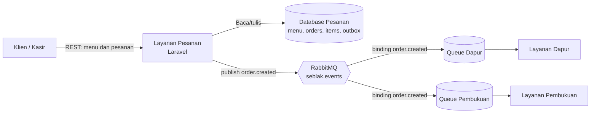

# Analisis Integrasi Sistem Warung Seblak Ngakak

**Mata kuliah:** 25IF1504 — Integrasi Sistem dan Komputasi Awan  
**Checkpoint:** 1 — Analisis, kontrak API, dan layanan berjalan  
**Kelompok:** Warung Seblak Ngakak  
**Versi:** 1.0 — 1 November 2026

> Dokumen ini disiapkan sebagai sumber untuk PDF analisis checkpoint. Sebelum dikumpulkan, kelompok perlu memeriksa kembali nama anggota, sistem yang benar-benar dipakai mitra, dan URL repositori layanan Dapur/Pembukuan.

## 1. Konteks mitra dan proses bisnis

Warung Seblak Ngakak merupakan mitra usaha makanan yang menerima pesanan beberapa menu dengan variasi jumlah, harga, dan ketersediaan. Proses bisnis yang menjadi ruang lingkup proyek adalah pencatatan pesanan pelanggan, pemeriksaan ketersediaan menu, pengurangan stok, persiapan pesanan oleh dapur, dan pencatatan transaksi penjualan oleh pembukuan.

Pada proses manual, informasi transaksi perlu diteruskan dari pihak yang menerima pesanan kepada dapur dan pembukuan. Informasi yang sama dapat dicatat ulang oleh pihak berbeda. Risiko yang muncul meliputi salah tulis item/jumlah, perbedaan nilai total, terlambatnya informasi pesanan ke dapur, dan kesulitan menelusuri status pesanan. Sistem yang dikembangkan membagi tanggung jawab tersebut ke dalam layanan terpisah agar data transaksi memiliki sumber yang jelas.

Sistem yang sudah ada di dalam lingkup kelompok adalah:

| Sistem/layanan | Data utama | Tanggung jawab |
|---|---|---|
| Layanan Pesanan (Kasir) | Menu, harga, stok, pesanan, rincian item, outbox | Menerima pesanan, menghitung total, mengurangi stok, mencatat transaksi, dan menerbitkan event |
| Layanan Dapur | Antrian dan status persiapan pesanan | Menerima event pesanan dan mengelola proses masak |
| Layanan Pembukuan | Catatan/jurnal penjualan | Menerima event pesanan dan mencatat transaksi untuk pembukuan |
| RabbitMQ | Pesan event dan antrean tiap konsumen | Meneruskan event dari penerbit ke layanan penerima |

Layanan Pesanan adalah satu-satunya layanan yang memiliki sumber data menu, harga, stok, dan transaksi penjualan. Dapur bertanggung jawab pada antrean kerja dapur; Pembukuan bertanggung jawab pada catatan jurnal. Data yang diterima kedua layanan lain merupakan salinan yang dibutuhkan untuk tugasnya, bukan sumber utama untuk mengubah harga atau stok.

## 2. Persoalan integrasi dan pihak terdampak

Tanpa pertukaran data yang konsisten, setiap bagian dapat memiliki catatan dengan versi berbeda. Pesanan yang berubah atau dibatalkan mungkin tidak segera diketahui dapur. Pembukuan dapat menerima total yang tidak sama dengan total yang dihitung kasir. Stok yang dicatat terpisah juga dapat menyebabkan menu tetap ditawarkan meskipun bahan/menu telah habis.

Pihak yang terdampak adalah pelanggan (kejelasan penerimaan dan status pesanan), kasir (ketepatan pencatatan dan stok), dapur (urutan serta rincian pekerjaan), pembukuan (kelengkapan dan akurasi transaksi), dan pemilik/pengelola (pemantauan operasional). Sumber masalah utamanya adalah data tersebar dan proses meneruskan perubahan masih bergantung pada pencatatan atau komunikasi antarbagian.

Integrasi yang dirancang mengurangi pencatatan ulang dengan menerbitkan satu event pesanan dari layanan yang berwenang. Dapur dan Pembukuan menerima salinan event masing-masing. Pemisahan ini membuat konsumen dapat bekerja secara independen, namun menuntut kontrak event yang stabil, penanganan pesan gagal, dan konsumen yang aman menerima pesan berulang.

## 3. Rancangan arsitektur

Diagram menunjukkan tiga layanan aplikasi dan dua jalur integrasi. Klien menggunakan REST untuk meminta daftar menu atau membuat pesanan. Layanan Pesanan menyimpan pesanan dan event outbox dalam satu transaksi database. Setelah transaksi berhasil, publisher mengirim event ke RabbitMQ. Exchange menyalin event ke queue Dapur dan Pembukuan masing-masing; kedua consumer memproses antreannya secara terpisah.

Di repo Layanan Pesanan, consumer demonstrasi mendeklarasikan queue `seblak.orders` untuk membuktikan jalur event lokal. Queue produksi Dapur dan Pembukuan harus dideklarasikan dan diikat oleh repo layanan penerima. Nama queue pada diagram merupakan nama kontrak/topologi kelompok dan perlu disamakan dengan konfigurasi kedua repo tersebut.

### Batas tanggung jawab layanan

- **Layanan Pesanan (Kasir):** sumber utama menu, harga, stok, transaksi, dan rincian pesanan; menyediakan REST API; menerbitkan `order.created`.
- **Layanan Dapur:** menyimpan antrean masak, menampilkan item dan jumlah, serta mengelola tahapan kerja dapur. Layanan ini tidak mengubah harga transaksi.
- **Layanan Pembukuan:** mencatat nilai penjualan dari event dan mencegah pencatatan ganda. Layanan ini tidak mengubah data pesanan sumber.
- **RabbitMQ:** mengirim event ke antrean yang terikat. Broker bukan database utama transaksi.

## 4. Pilihan gaya integrasi dan trade-off

| Pasangan/arah | Gaya | Alasan pemilihan | Trade-off |
|---|---|---|---|
| Klien/Kasir → Layanan Pesanan | REST sinkron | Klien membutuhkan jawaban langsung untuk validasi menu dan hasil pembuatan pesanan. | Sederhana dan mudah didemokan; klien bergantung pada ketersediaan API dan menunggu respons. |
| Layanan Pesanan → database Pesanan | Akses database lokal melalui transaksi | Pesanan, item, stok, dan event outbox harus konsisten di dalam satu batas transaksi. | Konsistensi kuat di dalam layanan; database tidak dibagi langsung dengan Dapur atau Pembukuan. |
| Layanan Pesanan → Layanan Dapur | Event asinkron lewat RabbitMQ | Dapur perlu menerima pesanan tanpa menahan respons kasir dan memiliki antrean kerja sendiri. | Penerbit dan penerima lebih renggang; pemrosesan tertunda mungkin terjadi dan perlu retry serta deduplikasi. |
| Layanan Pesanan → Layanan Pembukuan | Event asinkron lewat RabbitMQ | Pembukuan dapat memproses transaksi secara terpisah dan tidak memperlambat pemesanan. | Status pembukuan tidak diketahui saat API menjawab; perlu pemantauan pesan gagal dan penanganan event berulang. |

Alternatif sinkron langsung dari Layanan Pesanan ke Dapur dan Pembukuan akan memudahkan memperoleh respons segera dari setiap layanan, tetapi pesanan menjadi tergantung pada seluruh layanan penerima. Bila satu layanan mati, API pesanan berpotensi gagal atau lambat. Alternatif tersebut tidak dipilih untuk notifikasi pembuatan pesanan.

Event dapat tertunda dibanding REST, tetapi satu queue per penerima membuat Dapur dan Pembukuan menerima salinan sendiri dan bekerja tanpa saling berebut pesan. Konsekuensinya, sistem harus menerima konsistensi eventual: pesanan sudah diterima kasir sementara antrean dapur atau jurnal mungkin belum diperbarui beberapa saat.

## 5. Kontrak API dan event

Kontrak REST design-first berada di [`routes/openapi.yaml`](../routes/openapi.yaml). Endpoint layanan yang berjalan mencakup daftar menu, membuat pesanan, daftar pesanan, detail pesanan, dan perubahan status. Request pembuatan berisi `nama_pelanggan`, opsional `metode_pembayaran`, serta array `items` dengan `kode_menu` dan `jumlah`. API mengembalikan `201` saat pesanan dibuat dan Problem Details `application/problem+json` untuk data tidak valid (`422`), resource tidak ditemukan (`404`), atau transisi status yang tidak diperbolehkan (`409`).

Kontrak event kelompok:

| Atribut | Nilai |
|---|---|
| Nama event | `order.created` (bentuk lampau) |
| Exchange | `seblak.events` (`topic`, durable) |
| Routing key | `order.created` |
| Penerbit | Layanan Pesanan / `OrderPublisher` |
| Penerima | Layanan Dapur dan Layanan Pembukuan; consumer lokal repo pesanan untuk demonstrasi |
| Format | JSON, `content_type: application/json`, pesan persistent |

Pesan membawa `event_id` (UUID stabil), `event` (string), `data` (objek pesanan beserta `items`), dan `occurred_at` (string ISO-8601). `event_id` dipakai penerima sebagai kunci idempotensi. Bentuk payload lengkap dan tipe setiap field dicantumkan pada bagian **Kontrak Event** di README.

## 6. Outbox, kegagalan, dan batas jaminan

Layanan Pesanan membuat baris outbox di transaksi yang sama dengan pesanan dan item. Karena itu, transaksi tidak dapat commit dengan pesanan tetapi kehilangan catatan event. Publisher mencoba mengirim setelah commit. Jika RabbitMQ tidak tersedia, API tetap dapat mengembalikan pesanan yang tersimpan, sedangkan baris outbox menyimpan jumlah percobaan dan galat terakhir. Operator dapat menjalankan `php artisan outbox:publish` untuk mencoba ulang.

Penerbit menggunakan publisher confirms, pesan persistent, dan routing mandatory. Outbox menandai event terkirim setelah menerima confirm dan memastikan pesan tidak dikembalikan karena tidak ada queue yang cocok. Jika proses berhenti setelah broker menerima pesan tetapi sebelum `published_at` disimpan, retry dapat mengirim duplikat. Karena itu, pola ini memberi pengiriman minimal-sekali (*at-least-once*), bukan tepat-satu-kali. Setiap consumer produksi harus mencatat `event_id` yang sudah diproses dan memiliki kebijakan penanganan pesan gagal.

## 7. Persiapan demonstrasi dan kelanjutan

Sebelum checkpoint, siapkan Docker/Sail dan image container, jalankan migrasi termasuk tabel outbox, dan pastikan RabbitMQ sehat. Siapkan Swagger UI atau curl dan jalankan consumer pada terminal lain. Demonstrasi dapat mengikuti README: satu request sukses, satu request gagal dengan Problem Details, feature test, lalu event yang tampil di consumer. Jika event tertunda, jalankan perintah retry outbox.

Setiap anggota perlu menjelaskan tanggung jawabnya serta kontribusi commit di repo kelompok. Sebelum PDF dikumpulkan, kelompok perlu memeriksa bahwa diagram dan nama queue cocok dengan implementasi repositori Dapur/Pembukuan serta menjalankan Spectral terhadap `openapi.yaml`.
